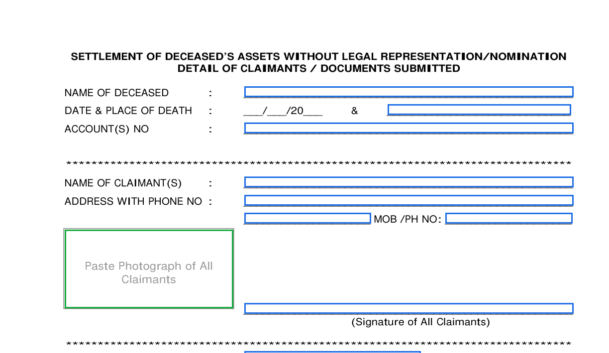

# PDF Studio — OCR & Form Filling

I kept getting sent scanned bank/insurance forms with no fillable fields at
all — just blank lines and boxes on a flat image — and no clean way to fill
them in on Windows without printing and scanning again. This finds those
fields itself (boxes, comb fields, table cells, checkboxes) using OCR and
some OpenCV, so you can type straight into a scanned form like it was a real
PDF form to begin with.

A Windows 11–styled PDF editor that can OCR pages, recognise form fields
(both embedded AcroForm fields and blank lines/checkboxes on flat scans), let
you fill them in, and save a finished PDF.


## Features
- **Open & view** any PDF with crisp, zoomable rendering. **Drag & drop** a
  PDF or Word file onto the window to open it.
- **OCR** using the **built-in Windows engine** (no Tesseract / external binary).
  Recognise the current page or every page; copy the extracted text.
- **Recognise empty forms**
  - Embedded **AcroForm** fields are read automatically on open.
  - **Flat / scanned** forms: fillable areas are recognised **automatically on
    open** (and OCR runs on the first page). Detection finds **boxes** (bordered
    answer/comment boxes — tall ones become multi-line fields), **table cells**
    (each cell of a ruled grid, e.g. a "Details" column), **comb fields** (rows
    of per-character cells like NAME / ACCOUNT NO — filled one character per
    cell), **lines** (ruled write-on lines) and **checkboxes** with OpenCV.
    Lines that merely trace a box edge are suppressed.
- **Opens `.doc` / `.docx` / `.rtf`** by auto-converting to PDF via the Word
  installed on the machine.
- **Encrypted PDFs** — tries an empty password automatically and prompts for one
  if the document is truly locked.
- **Fill in** fields right on the page (text boxes, multi-line boxes,
  checkboxes, dropdowns).
- **Three ink colours** — black, blue, red — applied to typed text and signatures.
- **Signatures** — draw a signature freehand, drag to position, drag the corner
  to resize, press Delete to remove; it's stamped into the saved PDF.
- **Save** a filled PDF — AcroForm values are written into the form; detected
  fields are stamped as text and signatures as images. The result is a normal,
  portable PDF.
- **Windows 11 / Fluent** UI (Mica title bar, navigation rail, command bar,
  light/dark theme toggle).
- **Standalone EXE + installer** with a desktop shortcut.

## Stack
| Concern | Library |
|---|---|
| UI | PySide6 + PySide6-Fluent-Widgets |
| PDF render / forms | PyMuPDF (fitz) |
| OCR | winocr → Windows.Media.Ocr |
| Field detection | OpenCV + NumPy |

## Run from source
```powershell
python app.py
```
Dependencies: `pip install --user "PySide6-Fluent-Widgets[full]" PyMuPDF opencv-python-headless winocr pillow`

## Build the EXE
```powershell
python -m PyInstaller --noconfirm --onefile --windowed --name "PDF Studio" `
  --collect-all qfluentwidgets --collect-submodules winrt --collect-all winrt_runtime `
  --hidden-import winrt.windows.media.ocr --hidden-import winrt.windows.globalization `
  --hidden-import winrt.windows.storage.streams --hidden-import winrt.windows.graphics.imaging `
  --hidden-import winrt.windows.foundation --hidden-import winrt.windows.foundation.collections `
  --distpath "..\" app.py
```
The resulting `PDF Studio.exe` is dropped at the Desktop\claude code root.

## Build the installer
After building the EXE, compile the Inno Setup script (Inno Setup 6 required):
```powershell
& "C:\Program Files (x86)\Inno Setup 6\ISCC.exe" installer.iss
```
Produces `PDF Studio Setup.exe` at the Desktop\claude code root. It installs
per-user (no admin), adds Start Menu + optional Desktop shortcuts, and registers
an uninstaller.

## Files
- `app.py` — entry point
- `mainwindow.py` — Fluent window, command bar, colour + signature actions
- `viewer.py` — page view + editable field overlays + signature items
- `pdfcore.py` — load / render / read & fill fields / stamp text & signatures / save
- `formdetect.py` — blank-field detection (boxes + lines + checkboxes)
- `ocrengine.py` — Windows OCR wrapper
- `signature.py` — freehand signature canvas + dialog
- `docimport.py` — Word `.doc`/`.docx` → PDF conversion (via COM)
- `make_icon.py` — generates `icon.ico`
- `installer.iss` — Inno Setup installer script
- `test_full.py` — exhaustive headless test harness (run: `python test_full.py`)
- `detect_report.py` — annotated detection previews for sample forms

## Notes
- OCR needs the Windows OCR language pack (English ships by default on Win11).
  If missing: `Add-WindowsCapability -Online -Name "Language.OCR~~~en-US~0.0.1.0"`.

## Detection examples


